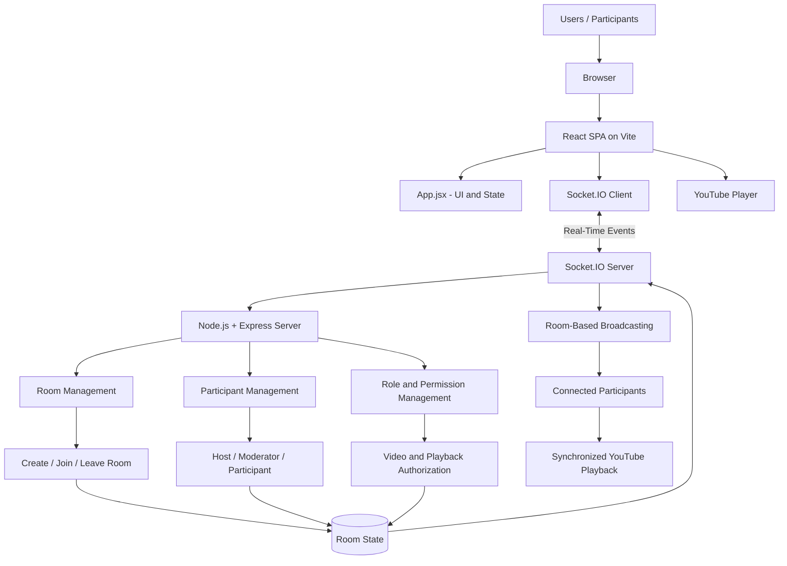
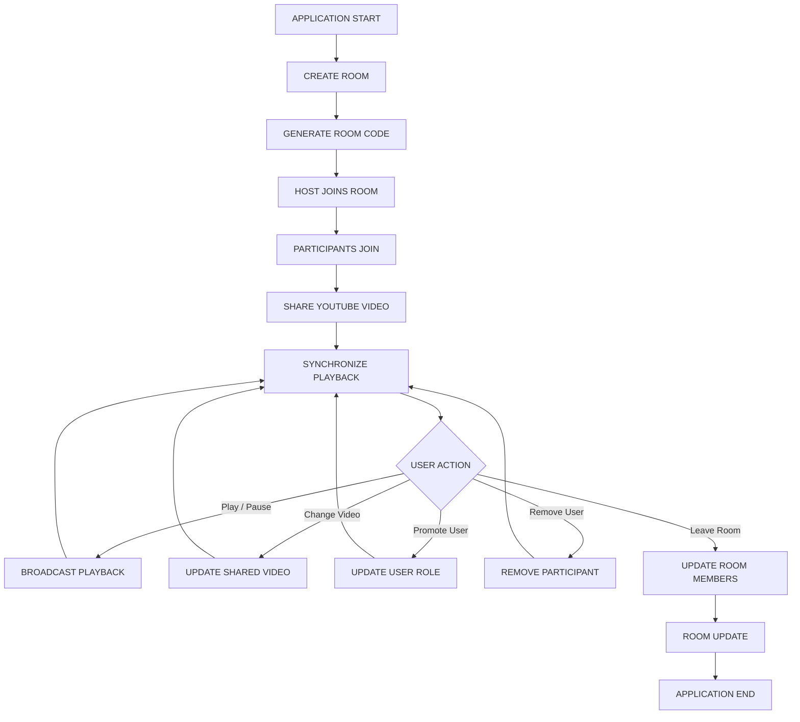
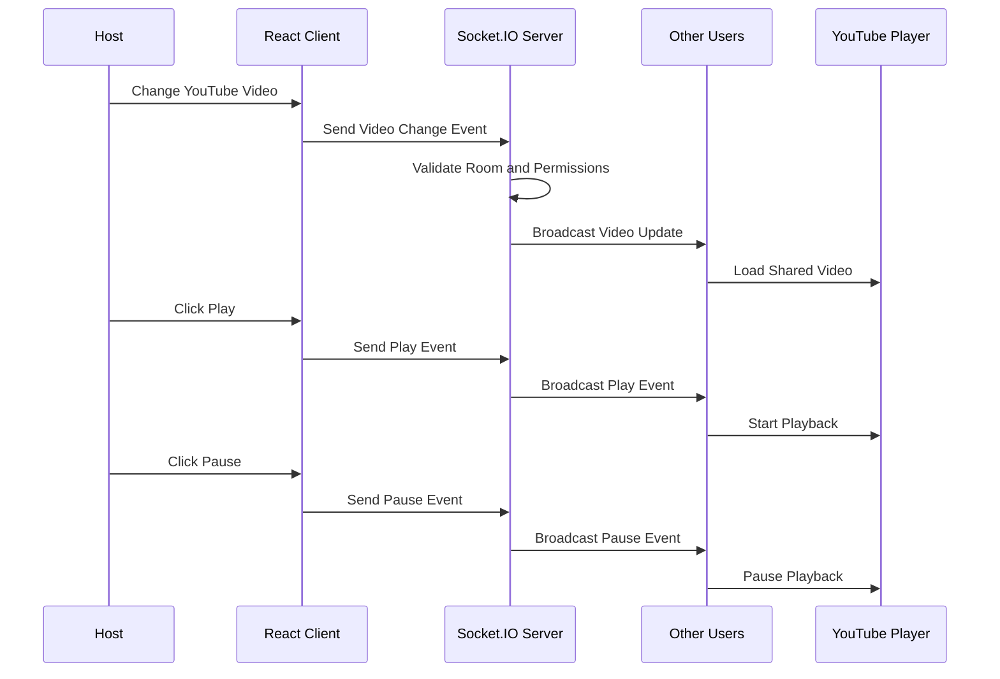

# 🎬 YouTube Watch Party

A real-time YouTube Watch Party web application that allows users to create rooms, invite friends using a unique room code, and watch YouTube videos together with synchronized playback.

## 🌐 Live Demo & Project Links

- **Live Application:** https://youtube-watch-party-client-vx28.onrender.com
- **Backend Server:** https://youtube-watch-party-project.onrender.com
- **GitHub Repository:** https://github.com/ritesh975/YouTube-Watch-Party-project

> **Note:** The frontend and backend are deployed separately on Render. The backend may take some time to respond after a period of inactivity because it uses a free instance.

## 📌 Project Overview

YouTube Watch Party is a real-time web application built with React, Node.js, Express, and Socket.IO. Users can create a watch room, share its room code with friends, and synchronize YouTube video playback.

The application supports multiple participants, host and moderator permissions, video sharing, participant management, and room-leaving notifications.

## 🏗️ Architecture

### System Architecture

YouTube Watch Party follows a Client–Server Architecture with real-time communication using Socket.IO. The React frontend manages the user interface and YouTube player, while the Node.js and Express backend handles room management, participants, permissions, and real-time events.



### Application Lifecycle



### Real-Time Communication Flow



### Architecture Components

| Component | Responsibility |
|---|---|
| `main.jsx` | Initializes the React application |
| `App.jsx` | Manages the main UI, room interactions, and application state |
| `style.css` | Handles styling and responsive design |
| `index.js` (Backend) | Initializes Express and Socket.IO server |
| Socket.IO Client | Connects frontend to backend |
| Socket.IO Server | Handles real-time communication and room broadcasting |
| Room Management | Creates rooms and manages participants |
| Role Management | Controls Host, Moderator, and Participant permissions |
| React YouTube | Embeds and controls the YouTube video player |

## ✨ Features

- **Create Room:** Create a room with a unique room code.
- **Join Room:** Join an existing room using its room code.
- **Real-Time Participants:** View participants and their roles.
- **YouTube Video Sharing:** Change the video for everyone in the room.
- **Playback Synchronization:** Synchronize play and pause actions between users.
- **Role Management:** The host can promote participants to moderators.
- **Participant Removal:** The host can remove participants from a room.
- **Room Management:** Update the participant list when users leave or disconnect.
- **Host Disconnect Handling:** Notify participants when the host leaves.
- **Responsive UI:** Dark-themed interface designed for desktop and smaller screens.
- **Real-Time Communication:** Socket.IO enables communication between connected clients.

## 🛠️ Technologies Used

### Frontend
- React
- Vite
- JavaScript (ES6+)
- CSS
- Socket.IO Client
- React YouTube

### Backend
- Node.js
- Express.js
- Socket.IO
- CORS

### Deployment
- Render — frontend and backend hosting
- GitHub — source code and version control

## 📁 Project Structure

```text
youtube-watch-party/
├── client/
│   ├── src/
│   │   ├── App.jsx
│   │   ├── main.jsx
│   │   └── style.css
│   ├── index.html
│   ├── package.json
│   └── vite.config.js
├── server/
│   ├── index.js
│   ├── package.json
│   └── package-lock.json
├── .gitignore
└── README.md
```

## ⚙️ Installation and Setup

### Prerequisites

Install the following tools before running the project:

- [Node.js](https://nodejs.org/)
- [Git](https://git-scm.com/)
- A modern web browser

### 1. Clone the Repository

Open your terminal and run:

```bash
git clone https://github.com/ritesh975/YouTube-Watch-Party-project.git
cd YouTube-Watch-Party-project/youtube-watch-party
```

### 2. Install Frontend Dependencies

```bash
cd client
npm install
```

### 3. Start the Frontend

```bash
npm run dev
```

Open the local frontend URL shown in your terminal. With the default Vite configuration, it is usually:

http://localhost:5173

### 4. Install Backend Dependencies

Open a **second terminal** and navigate to the project's `server` directory:

```bash
cd path/to/YouTube-Watch-Party-project/youtube-watch-party/server
npm install
```

Replace `path/to/` with the actual location of your cloned project.

### 5. Start the Backend

```bash
npm start
```

If your `server/package.json` does not define a `start` script, use:

```bash
node index.js
```

The backend normally runs locally at:

http://localhost:3000

Keep the frontend and backend running simultaneously during local development.

> **Important:** The frontend's Socket.IO URL must point to your local backend during local development and the deployed backend URL when using the live application.

## 🧪 How to Test

1. Open the application in a browser.
2. Enter a username and click **Create Room**.
3. Copy the generated room code.
4. Open another browser or an Incognito window.
5. Enter a different username and join using the same room code.
6. Change the YouTube video and verify it updates for both users.
7. Test play and pause synchronization.
8. Promote a participant to Moderator.
9. Test participant removal.
10. Test what happens when the host leaves the room.

## 🔐 Roles and Permissions

| Role | Permissions |
|---|---|
| **Host** | Creates the room, changes videos, controls playback, manages moderators, and removes participants. |
| **Moderator** | Can change videos and control playback. |
| **Participant** | Joins the room and watches the shared video. |

## 🚀 Deployment

The application is deployed using Render.

- **Frontend:** https://youtube-watch-party-client-vx28.onrender.com
- **Backend:** https://youtube-watch-party-project.onrender.com

### Deployment Checklist

- [ ] Frontend is deployed successfully.
- [ ] Backend is running successfully.
- [ ] Frontend Socket.IO URL points to the deployed backend.
- [ ] Backend CORS allows the deployed frontend origin.
- [ ] Room creation and joining work online.
- [ ] Video changes and playback synchronization work across browsers.

## 🔮 Future Improvements

- Add real-time chat and emoji reactions.
- Improve synchronization when users seek through a video.
- Synchronize playback for participants joining late.
- Improve reconnection and error handling.
- Add authentication and user profiles.
- Improve accessibility and mobile user experience.

## 👨‍💻

**Ritesh Kumar Kasaudhan**

- **GitHub:** https://github.com/ritesh975
- **Project Repository:** https://github.com/ritesh975/YouTube-Watch-Party-project
- **Live Demo:** https://youtube-watch-party-client-vx28.onrender.com

---

*Built with ❤️ using React, Node.js, Express, and Socket.IO.*
